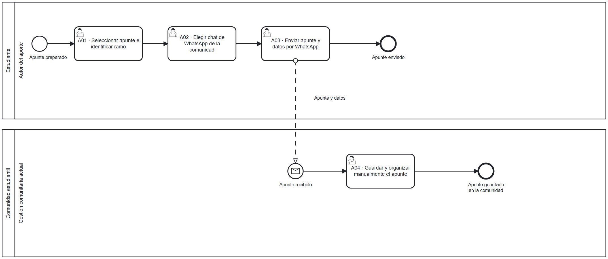
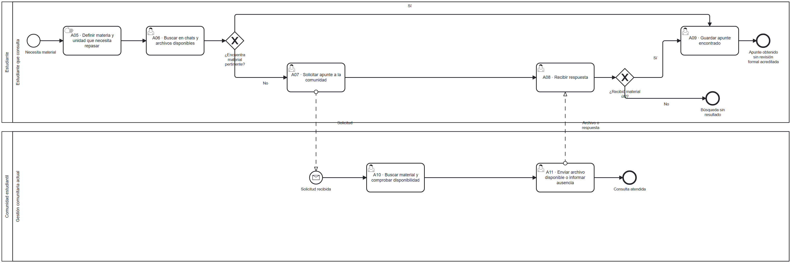

# Proceso de negocio AS-IS

## Macroproceso y procesos específicos

Gestión comunitaria de material académico → compartir apuntes y buscar u obtener apuntes.

Se modelan dos procesos relacionados dentro del mismo alcance. El primero explica cómo llega material a la comunidad; el segundo, cómo lo obtiene un estudiante.

## Ficha de proceso

| Campo | Descripción                                                                                       |
|---|---------------------------------------------------------------------------------------------------|
| Objetivo de negocio | Facilitar el intercambio y acceso a apuntes pertinentes para estudiar asignaturas universitarias. |
| Inicio de compartir | Un estudiante dispone de un apunte que desea compartir.                                           |
| Fin de compartir | El apunte fue enviado y la comunidad lo guardó.                                                   |
| Inicio de buscar | Un estudiante necesita material de una materia o unidad.                                          |
| Fin de buscar | Obtiene un apunte o termina sin material adecuado tras la respuesta de la comunidad.              |
| Entradas | Archivo del apunte, información disponible del ramo y necesidad de estudio.                       |
| Salidas | Archivo compartido o material obtenido; no se presupone certificación de su corrección.           |
| Canales actuales descritos | Amigos y conocidos, grupos de WhatsApp o Discord.                                                 |
| Responsable organizacional | Comunidad estudiantil.                                                                            |
| Límite | Intercambio y obtención de material.                                                              |

## Participantes y sus objetivos

| Participante | Objetivo |
|---|---|
| Estudiante que aporta | Compartir material que pueda ser encontrado y utilizado por otros. |
| Estudiante que consulta | Obtener material del ramo y tema adecuados y evaluar si le resulta confiable. |
| Comunidad estudiantil | Facilitar el intercambio y la localización del material recibido. |

Las dos funciones de estudiante pueden corresponder a la misma persona. En los diagramas se mantiene el participante Estudiante y el participante Comunidad estudiantil.

## Base del modelo

El [acta de elicitación](./05-elicitacion.md) describe la búsqueda mediante conocidos y WhatsApp, la dispersión del material y la incertidumbre sobre su confiabilidad. La recepción organizada de archivos y la atención de consultas por la comunidad se incorporan como supuestos del modelo. Una solicitud puede permanecer sin respuesta.

## Diagramas AS-IS

### Compartir apuntes

[Fuente BPMN](./diagramas/as-is-publicacion.bpmn)

### Buscar y obtener apuntes

[Fuente BPMN](./diagramas/as-is-busqueda.bpmn)

## Tipos de tarea

La definición de la materia que se necesita repasar se representa como tarea manual porque es una decisión de la persona sin apoyo necesario de un sistema. Buscar archivos, elegir un chat, escribir una solicitud y guardar material son tareas de usuario porque una persona utiliza una aplicación.

Los carriles delimitan la función de cada participante. Las secuencias permanecen en su proceso y los mensajes representan los intercambios entre participantes.

## Problemas identificados

| ID | Problema y fundamento                                                                   | Participante y objetivo afectado |
|---|-----------------------------------------------------------------------------------------|---|
| PR-01 | Material disperso en conversaciones y contactos.                                        | Estudiante: encontrar material pertinente sin revisar múltiples canales. |
| PR-02 | Falta de información suficiente para evaluar la confiabilidad.                          | Estudiante: saber qué revisión respalda un apunte. |
| PR-03 | Clasificación inconsistente por ramo y unida                                            | Estudiante y comunidad: ubicar y organizar material. |
| PR-04 | Posible trabajo repetido al recibir, clasificar y reenviar archivos.                    | Comunidad: gestionar los aportes con esfuerzo sostenible. |
| PR-05 | Responsabilidades, correcciones y seguimiento poco definidos como hipótesis de trabajo. | Comunidad y autor: resolver aportes sin perder decisiones o versiones. |
