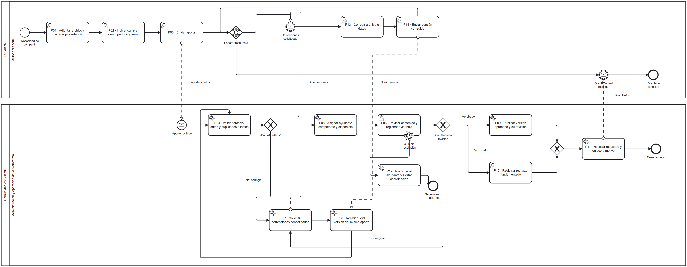
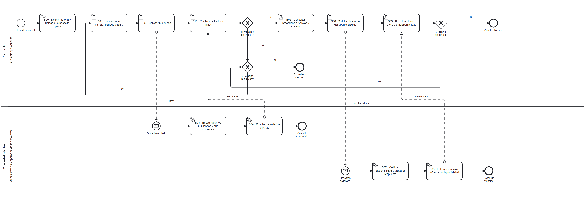
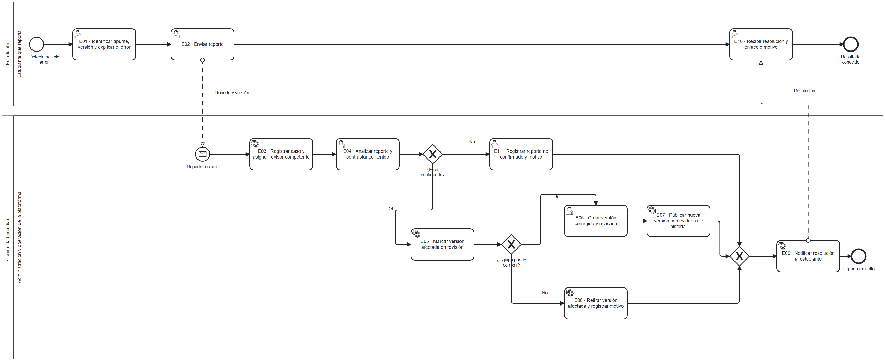

# Análisis de rediseño y propuesta TO-BE

## Alcance

Se propone centralizar aportes, revisión, publicación, búsqueda y mantenimiento de apuntes, con revisión académica antes de publicar. Los participantes son Estudiante y Comunidad estudiantil; esta última representa a la administración, los ayudantes y la operación de los servicios automáticos.

## Mejoras identificadas por participante

| Participante | Objetivo | Problema | Mejora deseada |
|---|---|---|---|
| Estudiante que consulta | Encontrar material pertinente y evaluar su confiabilidad. | PR-01, PR-02, PR-03. | Catálogo filtrable, ficha de revisión y descarga de la versión seleccionada. |
| Autor del aporte | Compartir y conocer el resultado. | PR-03, PR-05. | Formulario claro, observaciones, correcciones y resolución identificable. |
| Comunidad estudiantil | Organizar y revisar con responsabilidades claras. | PR-04 y PR-05 (hipótesis). | Validación inicial, asignación, historial y seguimiento. |

## Criterios de la propuesta

| ID | Criterio |
|---|---|
| D01 | Revisar antes de publicar; solo la versión aprobada entra al catálogo. |
| D02 | Asignar la revisión a ayudantes habilitados por ramo; coordinación gestiona disponibilidad y autorización. |
| D03 | Clasificar por carrera, ramo, período académico y tema o unidad. Período académico y nivel de carrera son conceptos distintos. |
| D04 | Aplicar controles de archivo, formatos y tamaño configurables, y detección de duplicados. |
| D05 | Generar un recordatorio no interruptivo a las 48 horas desde el inicio de la revisión. |
| D06 | Mantener el identificador del aporte y crear una versión nueva al recibir correcciones. |
| D07 | Investigar los reportes y corregir o retirar las versiones con errores confirmados. |
| D08 | Aplicar las metas y condiciones de calidad definidas en el documento 06. |

## Iniciativas de rediseño

### I01

- Objetivo y problema: Estudiante y comunidad: aportar y organizar material; PR-03, PR-04.
- Actividades AS-IS afectadas: A01–A04.
- Heurísticas: **Interfacing, Control relocation y Task composition**.
- Cambio propuesto: Recibir archivo y clasificación en un aporte único, permitir correcciones y verificar campos.
- Efecto esperado y costo de la mejora: Menos aclaraciones y retrabajo; un formulario demasiado largo puede desalentar aportes.
- Cambios trazables: C01, C02.

### I02

- Objetivo y problema: Estudiante: evaluar confiabilidad; PR-02.
- Actividades AS-IS afectadas: A04: recepción y organización del apunte; el modelo actual no representa un control académico formal.
- Heurísticas: **Control addition, Resequencing y Knock-out**.
- Cambio propuesto: Validar primero la entrada y después realizar una revisión académica documentada.
- Efecto esperado y costo de la mejora: Mejora esperada de calidad; puede aumentar la espera y carga del ayudante.
- Cambios trazables: C02, C03, C07.

### I03

- Objetivo y problema: Comunidad y autor: resolver cada aporte; PR-05.
- Actividades AS-IS afectadas: A03–A04: envío y organización del apunte.
- Heurísticas: **Split responsibilities, Order assignment y Contact reduction**.
- Cambio propuesto: Asignar responsable, devolver observaciones consolidadas y mantener versiones del mismo caso.
- Efecto esperado y costo de la mejora: Menos pérdida de contexto; la disponibilidad del mismo revisor puede limitar la rapidez.
- Cambios trazables: C02, C04, C05.

### I04

- Objetivo y problema: Estudiante: encontrar y obtener apuntes; PR-01, PR-03.
- Actividades AS-IS afectadas: A06–A11.
- Heurísticas: **Integral technology y Task automation**.
- Cambio propuesto: Consultar un catálogo filtrable y obtener una versión disponible con su ficha de revisión.
- Efecto esperado y costo de la mejora: Menor dependencia de respuestas por chat; requiere mantener clasificación e información actualizadas.
- Cambios trazables: C06, C07, C08.

### I05

- Objetivo y problema: Comunidad: dar seguimiento a aportes; PR-05.
- Actividades AS-IS afectadas: A03–A04: envío y organización, sin seguimiento representado en el modelo.
- Heurísticas: **Task automation y Case manager**.
- Cambio propuesto: Generar recordatorios y alertar a coordinación para gestionar demoras.
- Efecto esperado y costo de la mejora: Mayor visibilidad de pendientes; un plazo inadecuado genera alertas innecesarias.
- Cambios trazables: C09.

### I06

- Objetivo y problema: Estudiante y comunidad: mantener calidad del material; PR-02, PR-05.
- Actividades AS-IS afectadas: A04 y A09: almacenamiento y uso del material, sin una ruta de reportes representada.
- Heurísticas: **Order types, Exception y Control addition**.
- Cambio propuesto: Separar el proceso de reportes y registrar investigación, corrección revisada o retiro.
- Efecto esperado y costo de la mejora: Facilita tratamiento especializado; agrega trabajo de mantenimiento y coordinación.
- Cambios trazables: C10.

Las heurísticas proceden de Reijers, H. A. y Liman Mansar, S. (2005), *Best practices in business process redesign: an overview and qualitative evaluation of successful redesign heuristics*, Omega 33, 283–306, [DOI](https://doi.org/10.1016/j.omega.2004.04.012). Se utilizan como criterios de rediseño. El artículo evalúa tiempo, costo, calidad y flexibilidad y reconoce compensaciones entre ellas. En Split responsibilities se busca evitar responsabilidades ambiguas, no multiplicar aprobaciones.

## Diagramas TO-BE

### Publicación y revisión

[Fuente BPMN](./diagramas/to-be-publicacion.bpmn)

### Búsqueda y obtención

[Fuente BPMN](./diagramas/to-be-busqueda.bpmn)

### Reportes y mantenimiento

[Fuente BPMN](./diagramas/to-be-reportes.bpmn)

Los marcadores distinguen tareas de usuario, de servicio y manuales según su ejecución. Las decisiones académicas corresponden a personas. Validar campos, buscar el catálogo y publicar después de una aprobación son servicios automáticos. Definir la necesidad de estudio se modela como tarea manual.

El temporizador de publicación es no interruptivo: genera una alerta y permite que continúe la revisión. Las esperas de corrección pueden permanecer pendientes si el autor no responde. En búsqueda, los dos inicios por mensaje de la comunidad representan solicitudes independientes de consulta y descarga, cada una con su respuesta. P05 no debe completarse mientras el caso no tenga responsable disponible.

## Actividades que cambian del AS-IS al TO-BE

| Cambio | Actividad AS-IS | Actividad TO-BE | Qué cambia | Decisión |
|---|---|---|---|---|
| C01 | A01–A03: elegir y enviar un archivo por chat | P01–P03: adjuntar, clasificar y enviar aporte | Archivo y datos estructurados se reciben en una solicitud. | D03 |
| C02 | A04: guardar y organizar con intervención humana | P04–P05: validar entrada y asignar revisión | Controles automáticos y responsable competente. | D02, D04 |
| C03 | Control académico formal no representado en el modelo AS-IS | P06 y P10: revisar y registrar rechazo | Se introduce revisión documentada antes de publicar. | D01, D02 |
| C04 | Ciclo formal de correcciones no representado en el modelo AS-IS | P07, P08, P13 y P14: solicitar y recibir correcciones | Se mantiene el mismo caso y se revisa una nueva versión. | D01, D06 |
| C05 | A04: archivo guardado por la comunidad | P09 y P11: publicar y notificar | Solo se publica la versión aprobada; se comunica el resultado. | D01 |
| C06 | A06, A07 y A10: buscar en chats y pedir ayuda | B01–B04 y B10: filtrar y devolver resultados | Consulta autónoma de apuntes publicados mediante catálogo. | D03 |
| C07 | Ficha de revisión no representada en el modelo AS-IS | B05: consultar procedencia, versión y revisión | La información de revisión se hace visible al estudiante. | D01, D02 |
| C08 | A08, A09 y A11: recibir respuesta y guardar archivo | B06–B09: solicitar y atender descarga | Se verifica disponibilidad al descargar y se informa si falta. | D03 |
| C09 | Seguimiento de solicitudes no representado en el modelo AS-IS | P12: recordar y alertar coordinación | Seguimiento automático de una revisión demorada. | D05 |
| C10 | Proceso de reportes no representado en el modelo AS-IS | E01–E11: reportar, investigar, corregir o retirar y comunicar | Se propone mantenimiento posterior a la publicación. | D07 |

## Catálogo de actividades TO-BE

Los códigos figuran en las tareas de los diagramas. Los identificadores internos permiten localizar el elemento en el archivo fuente.

| Código | Actividad | Fuente BPMN | ID interno |
|---|---|---|---|
| P01 | Adjuntar archivo y declarar procedencia | [Fuente](./diagramas/to-be-publicacion.bpmn) | e1 |
| P02 | Indicar carrera, ramo, período y tema | [Fuente](./diagramas/to-be-publicacion.bpmn) | e2 |
| P03 | Enviar aporte | [Fuente](./diagramas/to-be-publicacion.bpmn) | es |
| P13 | Corregir archivo o datos | [Fuente](./diagramas/to-be-publicacion.bpmn) | fix |
| P14 | Enviar versión corregida | [Fuente](./diagramas/to-be-publicacion.bpmn) | resend |
| P04 | Validar archivo, datos y duplicados exactos | [Fuente](./diagramas/to-be-publicacion.bpmn) | check |
| P05 | Asignar ayudante competente y disponible | [Fuente](./diagramas/to-be-publicacion.bpmn) | assign |
| P06 | Revisar contenido y registrar evidencia | [Fuente](./diagramas/to-be-publicacion.bpmn) | review |
| P09 | Publicar versión aprobada y su revisión | [Fuente](./diagramas/to-be-publicacion.bpmn) | publish |
| P10 | Registrar rechazo fundamentado | [Fuente](./diagramas/to-be-publicacion.bpmn) | reject |
| P11 | Notificar resultado y enlace o motivo | [Fuente](./diagramas/to-be-publicacion.bpmn) | notify |
| P07 | Solicitar correcciones consolidadas | [Fuente](./diagramas/to-be-publicacion.bpmn) | request |
| P08 | Recibir nueva versión del mismo aporte | [Fuente](./diagramas/to-be-publicacion.bpmn) | corrected |
| P12 | Recordar al ayudante y alertar coordinación | [Fuente](./diagramas/to-be-publicacion.bpmn) | remind |
| B01 | Indicar ramo, carrera, período y tema | [Fuente](./diagramas/to-be-busqueda.bpmn) | filters |
| B02 | Solicitar búsqueda | [Fuente](./diagramas/to-be-busqueda.bpmn) | send |
| B10 | Recibir resultados y fichas | [Fuente](./diagramas/to-be-busqueda.bpmn) | results |
| B05 | Consultar procedencia, versión y revisión | [Fuente](./diagramas/to-be-busqueda.bpmn) | inspect |
| B06 | Solicitar descarga del apunte elegido | [Fuente](./diagramas/to-be-busqueda.bpmn) | download |
| B09 | Recibir archivo o aviso de indisponibilidad | [Fuente](./diagramas/to-be-busqueda.bpmn) | file |
| B00 | Definir materia y unidad que necesita repasar | [Fuente](./diagramas/to-be-busqueda.bpmn) | prep |
| B03 | Buscar apuntes publicados y sus revisiones | [Fuente](./diagramas/to-be-busqueda.bpmn) | query |
| B04 | Devolver resultados y fichas | [Fuente](./diagramas/to-be-busqueda.bpmn) | reply |
| B07 | Verificar disponibilidad y preparar respuesta | [Fuente](./diagramas/to-be-busqueda.bpmn) | serve |
| B08 | Entregar archivo o informar indisponibilidad | [Fuente](./diagramas/to-be-busqueda.bpmn) | sendfile |
| E01 | Identificar apunte, versión y explicar el error | [Fuente](./diagramas/to-be-reportes.bpmn) | detail |
| E02 | Enviar reporte | [Fuente](./diagramas/to-be-reportes.bpmn) | send |
| E10 | Recibir resolución y enlace o motivo | [Fuente](./diagramas/to-be-reportes.bpmn) | receive |
| E03 | Registrar caso y asignar revisor competente | [Fuente](./diagramas/to-be-reportes.bpmn) | register |
| E04 | Analizar reporte y contrastar contenido | [Fuente](./diagramas/to-be-reportes.bpmn) | review |
| E11 | Registrar reporte no confirmado y motivo | [Fuente](./diagramas/to-be-reportes.bpmn) | dismiss |
| E05 | Marcar versión afectada en revisión | [Fuente](./diagramas/to-be-reportes.bpmn) | flag |
| E06 | Crear versión corregida y revisarla | [Fuente](./diagramas/to-be-reportes.bpmn) | fix |
| E07 | Publicar nueva versión con evidencia e historial | [Fuente](./diagramas/to-be-reportes.bpmn) | publish |
| E08 | Retirar versión afectada y registrar motivo | [Fuente](./diagramas/to-be-reportes.bpmn) | withdraw |
| E09 | Notificar resolución al estudiante | [Fuente](./diagramas/to-be-reportes.bpmn) | notify |
