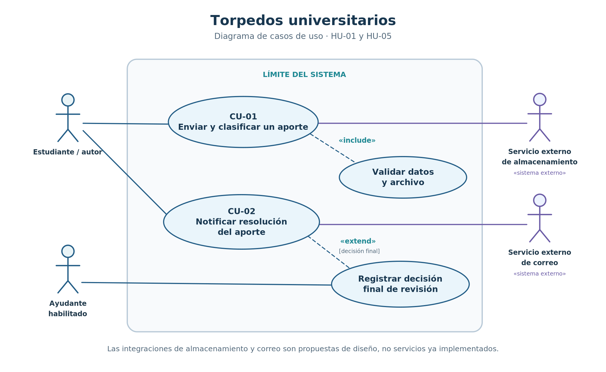
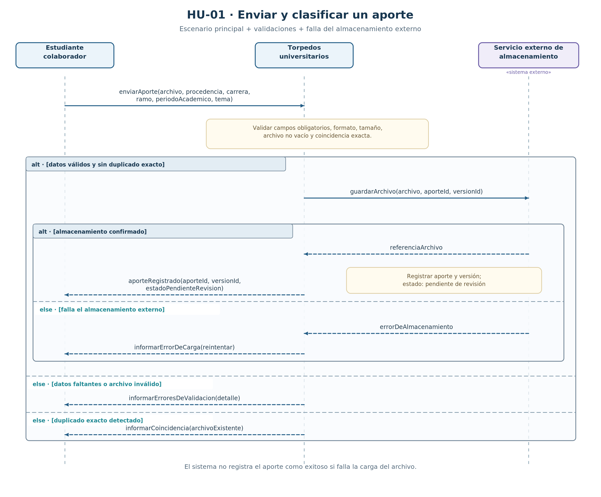
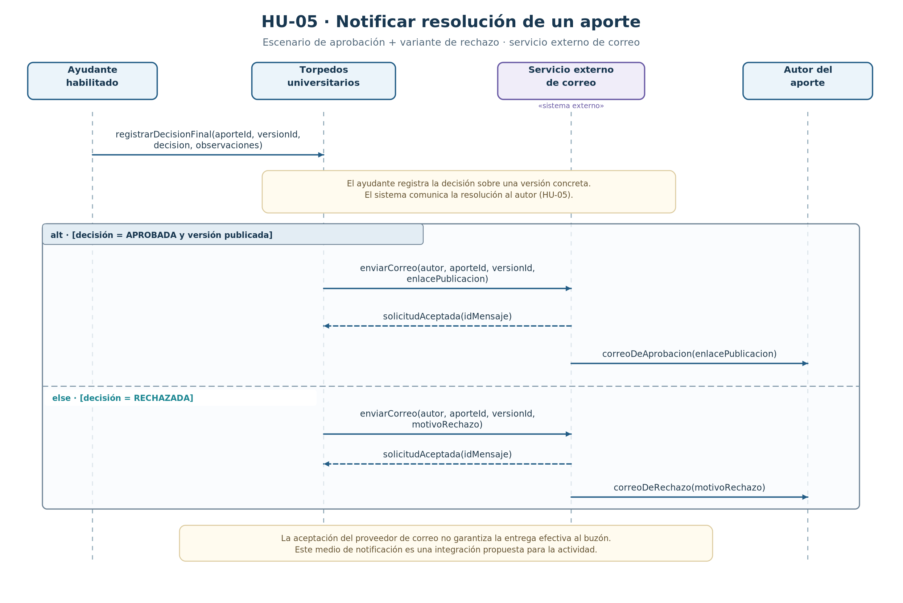

# Actividad: casos de uso y diagramas de secuencia con integración externa

## 1. Objetivo y alcance

Se modelan **dos historias de usuario existentes** del proyecto y una posible integración con otro sistema para cada una. El modelado es una **propuesta para la actividad**, no una afirmación de que los proveedores externos ya estén implementados. No se seleccionan marcas, API ni tecnologías específicas porque la documentación del repositorio no las define.

| Caso de uso | Historia de origen | Objetivo | Requisitos existentes | Sistema externo propuesto |
| --- | --- | --- | --- | --- |
| **CU-01** | **HU-01** | Enviar y clasificar un aporte académico | RP-01, RP-02 | Servicio externo de almacenamiento de archivos |
| **CU-02** | **HU-05** | Notificar al autor la resolución final de su aporte | RP-07 | Servicio externo de correo electrónico |

Referencias existentes: [`04-historias-usuario.md`](04-historias-usuario.md), [`03-requisitos.md`](03-requisitos.md), [`02-rediseno-to-be.md`](02-rediseno-to-be.md), [`07-trazabilidad.md`](07-trazabilidad.md).

## 2. Diagrama de casos de uso

**Fuente editable:** [`diagramas/casos-de-uso.puml`](diagramas/casos-de-uso.puml)

**Actores y límites del sistema:**

- **Estudiante / autor del aporte:** envía archivos para revisión y es el destinatario de su resolución.
- **Ayudante habilitado:** registra una decisión final de revisión; esto sirve como antecedente para CU-02 y proviene del flujo de HU-03.
- **Servicio externo de almacenamiento:** recibe el archivo asociado con un aporte y su versión (integración propuesta).
- **Servicio externo de correo:** recibe la solicitud de enviar la resolución al autor (integración propuesta).

**Relaciones UML:** CU-01 **incluye** validar los datos y el archivo porque toda solicitud se valida, incluso cuando se rechaza. CU-02 **extiende** registrar una decisión de revisión cuando existe una decisión final de aprobación o rechazo. La notificación no determina la aprobación; comunica una decisión previamente registrada.

## 3. CU-01 — Enviar y clasificar un aporte (HU-01)

**Historia original:** «Como estudiante que aporta material, quiero adjuntar y clasificar mi apunte, para que la comunidad lo reciba con la información necesaria».

**Actor principal:** estudiante colaborador.  
**Sistema externo:** almacenamiento de archivos.  
**Precondición:** el estudiante dispone de un archivo y sus datos para clasificarlo.  
**Postcondición de éxito:** queda registrado un aporte y una versión **pendiente de revisión**, con referencia al archivo almacenado; aún no está aprobado ni publicado.

### Escenario principal

1. El estudiante envía el archivo, procedencia, carrera, ramo, período académico y tema.
2. Torpedos universitarios valida los campos obligatorios, el archivo y la posible coincidencia exacta con otro archivo.
3. El sistema solicita guardar el archivo en el servicio externo de almacenamiento.
4. El servicio confirma el almacenamiento y devuelve la referencia al archivo.
5. El sistema registra el aporte y su versión en estado pendiente de revisión, y devuelve el identificador al estudiante.

### Variantes modeladas con `alt`

- **Datos faltantes o archivo inválido:** se informa qué debe corregirse y no se remite el aporte a revisión (HU-01-CA2).
- **Duplicado exacto:** se informa la coincidencia para resolverla; no se interpreta como validación académica (HU-01-CA3).
- **Falla del almacenamiento externo:** se informa el error y se ofrece reintentar sin afirmar que se registró correctamente el aporte. **Este escenario es una extensión de diseño propuesta**, no un criterio textual existente.

**Fuente editable:** [`diagramas/secuencia-hu-01-envio-aporte.puml`](diagramas/secuencia-hu-01-envio-aporte.puml)

**Trazabilidad:** HU-01 → CU-01 → RP-01/RP-02 → actividades TO-BE P01–P04 y P07 (validación/corrección de datos) → diagrama de secuencia HU-01.

## 4. CU-02 — Notificar resolución del aporte (HU-05)

**Historia original:** «Como autor de un aporte, quiero conocer la resolución de mi envío, para saber si se publicó o por qué fue rechazado».

**Actor beneficiario:** autor del aporte.  
**Actor que desencadena el evento:** ayudante habilitado, al registrar una decisión final en el flujo de revisión (HU-03).  
**Sistema externo:** servicio de correo electrónico.  
**Precondición:** existe una decisión final registrada para un aporte y una versión identificables.  
**Postcondición de éxito:** se ha enviado al proveedor externo la notificación correcta, con enlace si hubo aprobación y publicación, o motivo si hubo rechazo. La entrega efectiva del mensaje al buzón debe tratarse por separado.

### Escenario principal: aprobación

1. El ayudante habilitado registra una decisión final para una versión del aporte.
2. El sistema identifica que la decisión fue de aprobación y que la versión se publicó.
3. Solicita al servicio externo de correo notificar al autor, incluyendo el aporte, la versión y el enlace publicado.
4. El servicio de correo acepta la solicitud y se representa la entrega del correo al autor como camino principal.

### Variante modelada con `alt`: rechazo

1. La decisión final corresponde a un rechazo.
2. El sistema solicita al servicio externo de correo un mensaje con el motivo del rechazo, asociado al aporte y su versión.
3. Se representa la aceptación y entrega del correo al autor.

**Aclaración:** las solicitudes de corrección no equivalen a una resolución final aprobada/rechazada (HU-04 y RP-05); el diagrama cubre específicamente los resultados finales de HU-05.

**Fuente editable:** [`diagramas/secuencia-hu-05-notificacion.puml`](diagramas/secuencia-hu-05-notificacion.puml)

**Trazabilidad:** HU-05 → CU-02 → RP-07 → actividad TO-BE P11, antecedida por decisión de revisión (P06/P10 y publicación P09 según corresponda) → diagrama de secuencia HU-05.

## 5. Supuestos de diseño a validar con el equipo

1. Se adoptará un servicio de almacenamiento **externo al límite de Torpedos universitarios** para guardar archivos y conservar referencias por versión. El repositorio describe la función de carga, pero no exige una infraestructura externa concreta.
2. Se adoptará un **servicio externo de correo** como canal de notificación. El requisito existente exige informar al autor, no obliga a utilizar email.
3. Se simplifica la lógica interna de persistencia: los diagramas de secuencia de sistema tratan Torpedos universitarios como una caja negra. No se añaden controladores, clases, tablas ni API que no estén especificados.
4. El ayudante habilitado inicia CU-02 **indirectamente** mediante la decisión final registrada en el proceso de HU-03. El autor es destinatario de la notificación.
5. El rechazo informa un motivo registrado, y la aprobación un enlace a la versión efectivamente publicada, según RP-07; ninguna validación de archivo se presenta como aprobación académica.

## 6. Comprobación de la actividad

- [x] Dos historias de usuario existentes (`HU-01`, `HU-05`).
- [x] Una integración externa propuesta por historia, con responsabilidades diferenciadas.
- [x] Un diagrama de casos de uso que muestra actores, sistema y externos.
- [x] Un diagrama de secuencia por historia, con escenario principal y variante `alt`.
- [x] Identificadores `CU-01` y `CU-02` con trazabilidad explícita.
- [x] Fuentes editables `.puml` e imágenes `.png`.
- [x] Nombres acordes al modelo existente (aporte, versión, revisión, publicación y resolución).
- [ ] Validación del equipo sobre los dos **proveedores externos propuestos**, antes de afirmar que son decisiones definitivas de arquitectura.

## 7. Cómo visualizar o modificar

1. Abrir los archivos `.puml` en un editor con soporte PlantUML (por ejemplo, la extensión PlantUML en VS Code).
2. Modificar los nombres o mensajes si el equipo acuerda proveedores distintos.
3. Volver a exportar los `.puml` en PNG y reemplazar las imágenes de la misma carpeta.
4. Revisar en GitHub que los tres enlaces de imágenes de este documento se abran correctamente.
