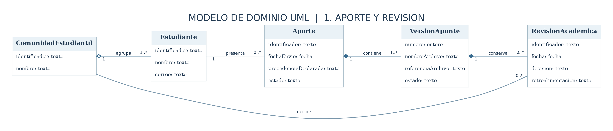
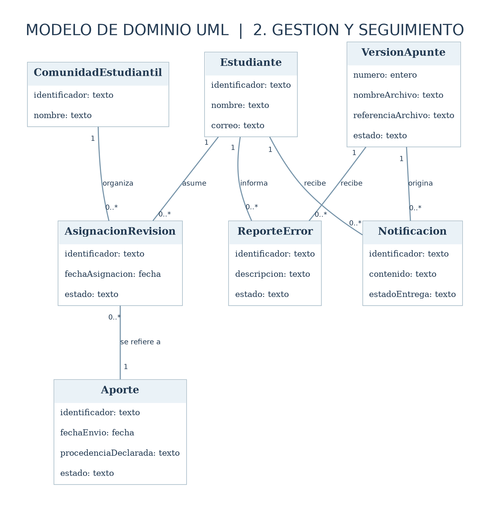
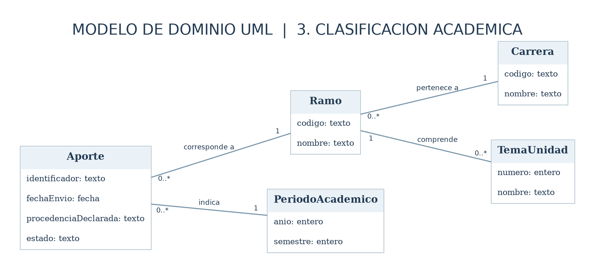

# Modelo de dominio

El modelo representa **conceptos del negocio** y no componentes técnicos. Se siguió la notación UML de clases: compartimentos de atributos, asociaciones con sus multiplicidades, agregación (rombo vacío) y composición (rombo lleno). No se incluyen métodos.

## Diagramas UML

Para evitar cruces de relaciones y mejorar la lectura, el modelo se presenta en **tres vistas UML del mismo dominio**. El núcleo incluye cinco clases y las otras vistas desarrollan el seguimiento y la clasificación académica. Todas tienen su fuente PlantUML editable.

### 1. Aporte y revisión comunitaria

Fuente: [`modelo-dominio.puml`](./diagramas/modelo-dominio.puml)

### 2. Organización y seguimiento

Fuente: [`modelo-dominio-gestion.puml`](./diagramas/modelo-dominio-gestion.puml)

### 3. Clasificación académica

Fuente: [`modelo-dominio-clasificacion.puml`](./diagramas/modelo-dominio-clasificacion.puml)

## Clases del dominio

| Clase | Significado | Atributos |
|---|---|---|
| `Estudiante` | Persona que puede aportar, consultar o participar en la revisión comunitaria, según el contexto. | identificador, nombre, correo |
| `ComunidadEstudiantil` | Colectivo de estudiantes que organiza las revisiones y decide sobre el material. | identificador, nombre |
| `Aporte` | Envío de apuntes realizado por un estudiante para revisión. | identificador, fechaEnvio, procedenciaDeclarada, estado |
| `VersionApunte` | Archivo concreto presentado, aprobado, rechazado o reemplazado. | numero, nombreArchivo, referenciaArchivo, estado |
| `AsignacionRevision` | Registro de organización de la revisión por un estudiante de la comunidad. | identificador, fechaAsignacion, estado |
| `RevisionAcademica` | Decisión de la comunidad sobre una versión, con fundamento y feedback. | identificador, fecha, decision, retroalimentacion |
| `Notificacion` | Comunicación del resultado de la revisión a quien envió el apunte. | identificador, contenido, estadoEntrega |
| `ReporteError` | Advertencia estudiantil sobre un posible error de un apunte. | identificador, descripcion, estado |
| `Carrera` | Carrera a la que pertenece una asignatura. | codigo, nombre |
| `Ramo` | Asignatura a la que corresponde el apunte. | codigo, nombre |
| `PeriodoAcademico` | Año y semestre del contenido. | anio, semestre |
| `TemaUnidad` | Unidad o tema que forma parte de un ramo. | numero, nombre |

## Relaciones UML

| Relación | Multiplicidades | Símbolo y justificación |
|---|---|---|
| ComunidadEstudiantil agrupa Estudiante | ComunidadEstudiantil `1`, Estudiante `1..*` | **Agregación (rombo vacío):** los estudiantes existen con independencia del colectivo. |
| Estudiante presenta Aporte | Estudiante `1`, Aporte `0..*` | Asociación: un aporte pertenece a un autor. |
| Aporte contiene VersionApunte | Aporte `1`, VersionApunte `1..*` | **Composición (rombo lleno):** las versiones pertenecen a su aporte e historial. |
| AsignacionRevision se refiere a Aporte | AsignacionRevision `0..*`, Aporte `1` | Asociación: se registran asignaciones de una revisión. |
| Estudiante asume AsignacionRevision | Estudiante `1`, AsignacionRevision `0..*` | Asociación: un integrante de la comunidad puede asumir revisiones. |
| ComunidadEstudiantil decide RevisionAcademica | ComunidadEstudiantil `1`, RevisionAcademica `0..*` | Asociación: la decisión es comunitaria y queda fundamentada. |
| ComunidadEstudiantil organiza AsignacionRevision | ComunidadEstudiantil `1`, AsignacionRevision `0..*` | Asociación: el colectivo organiza la revisión de aportes pendientes. |
| VersionApunte conserva RevisionAcademica | VersionApunte `1`, RevisionAcademica `0..*` | **Composición (rombo lleno):** cada revisión pertenece a una versión concreta. |
| VersionApunte recibe ReporteError | VersionApunte `1`, ReporteError `0..*` | Asociación: los reportes se refieren a una versión determinada. |
| Estudiante informa ReporteError | Estudiante `1`, ReporteError `0..*` | Asociación: se identifica al consultante que reportó el error. |
| VersionApunte origina Notificacion | VersionApunte `1`, Notificacion `0..*` | Asociación: los avisos se refieren a una versión. |
| Estudiante recibe Notificacion | Estudiante `1`, Notificacion `0..*` | Asociación: el autor es el destinatario. |
| Aporte corresponde a Ramo | Aporte `0..*`, Ramo `1` | Asociación: cada aporte corresponde a un ramo. |
| Aporte indica PeriodoAcademico | Aporte `0..*`, PeriodoAcademico `1` | Asociación: cada aporte declara un período. |
| Ramo pertenece a Carrera | Ramo `0..*`, Carrera `1` | Asociación: el ramo se organiza por carrera. |
| Ramo comprende TemaUnidad | Ramo `1`, TemaUnidad `0..*` | Asociación: cada tema corresponde a un ramo. |

## Decisiones de modelado

- **Roles, no clases distintas:** `Estudiante autor`, `Estudiante consultante` y `Comunidad estudiantil` son actores del diagrama de casos de uso. En el modelo de dominio, los individuos son instancias de `Estudiante`. La comunidad se representa como un colectivo asociado a esos estudiantes.
- **Revisión comunitaria:** la comunidad es el colectivo que organiza y modera. No se crean cargos independientes de los estudiantes. El modelo no presupone una votación ni un mecanismo de consenso no especificado.
- **Resultado de revisión:** la comunidad aprueba una versión y entonces se publica, o la rechaza con retroalimentación y no se publica. Una versión corregida requiere revisión nueva; no hereda la aprobación de versiones anteriores.
- **Integraciones externas:** almacenamiento de archivos y correo no son entidades del dominio; figuran únicamente en los diagramas donde interactúan con el sistema.
- **Símbolos UML:** no se fuerza herencia porque la información disponible no justifica subclases diferentes de estudiante. Sí se justifican agregación de la comunidad y composición del aporte y sus versiones.
