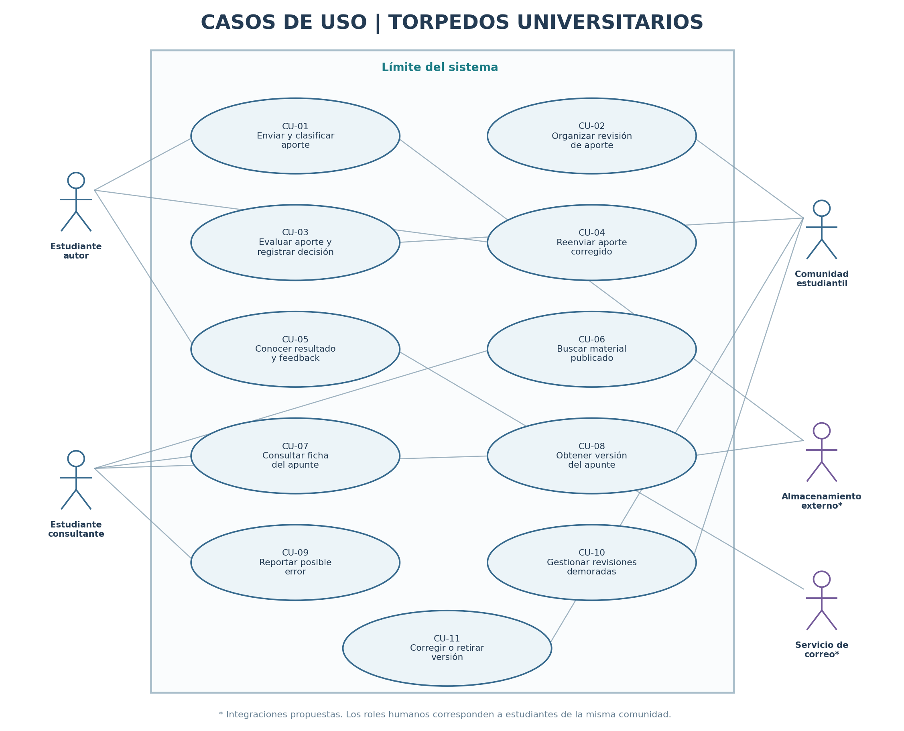

# Casos de uso

## Actores

Los tres actores humanos son roles desempeñados por estudiantes. La misma persona puede actuar como autor, consultante o integrante de la comunidad en diferentes circunstancias.

| Actor | Tipo | Descripción |
|---|---|---|
| Estudiante autor | Humano | Envía apuntes, conoce la decisión y puede presentar versiones corregidas. |
| Estudiante consultante | Humano | Busca, consulta, obtiene y reporta errores de los apuntes publicados. |
| Comunidad estudiantil | Colectivo humano | Estudiantes que organizan las revisiones, aceptan o rechazan aportes, entregan feedback y moderan el material. |
| Servicio de almacenamiento (propuesto) | Sistema externo | Resguarda los archivos de apuntes. |
| Servicio de correo (propuesto) | Sistema externo | Recibe solicitudes de envío de avisos de resolución. |

## Diagrama de casos de uso

Fuente editable: [`casos-de-uso.puml`](./diagramas/casos-de-uso.puml)

## Casos de uso y su origen

| ID | Objetivo del actor | Actor principal | Historia de origen |
|---|---|---|---|
| CU-01 | Enviar y clasificar aporte | Estudiante autor | [HU-01](./04-historias-usuario.md#hu-01) |
| CU-02 | Organizar revisión de aporte | Comunidad estudiantil | [HU-02](./04-historias-usuario.md#hu-02) |
| CU-03 | Evaluar aporte y registrar decisión | Comunidad estudiantil | [HU-03](./04-historias-usuario.md#hu-03) |
| CU-04 | Reenviar aporte corregido | Estudiante autor | [HU-04](./04-historias-usuario.md#hu-04) |
| CU-05 | Conocer resultado y feedback | Estudiante autor | [HU-05](./04-historias-usuario.md#hu-05) |
| CU-06 | Buscar material publicado | Estudiante consultante | [HU-06](./04-historias-usuario.md#hu-06) |
| CU-07 | Consultar ficha del apunte | Estudiante consultante | [HU-07](./04-historias-usuario.md#hu-07) |
| CU-08 | Obtener versión del apunte | Estudiante consultante | [HU-08](./04-historias-usuario.md#hu-08) |
| CU-09 | Reportar posible error | Estudiante consultante | [HU-09](./04-historias-usuario.md#hu-09) |
| CU-10 | Gestionar revisiones demoradas | Comunidad estudiantil | [HU-10](./04-historias-usuario.md#hu-10) |
| CU-11 | Corregir o retirar versión | Comunidad estudiantil | [HU-11](./04-historias-usuario.md#hu-11) |

## Reglas principales

1. Todo apunte recibido queda pendiente de revisión comunitaria; no se publica automáticamente.
2. La comunidad decide si aprueba o rechaza la versión y registra observaciones.
3. Si la aprueba, se publica la versión aprobada.
4. Si la rechaza, la versión no se publica y el autor recibe la justificación y el feedback para corregirla.
5. Si el autor presenta una nueva versión, esta vuelve al proceso de revisión.

El diagrama no incorpora relaciones `<<include>>` ni `<<extend>>` sin una dependencia de objetivos que las justifique. El almacenamiento y el correo se mantienen como integraciones propuestas.
