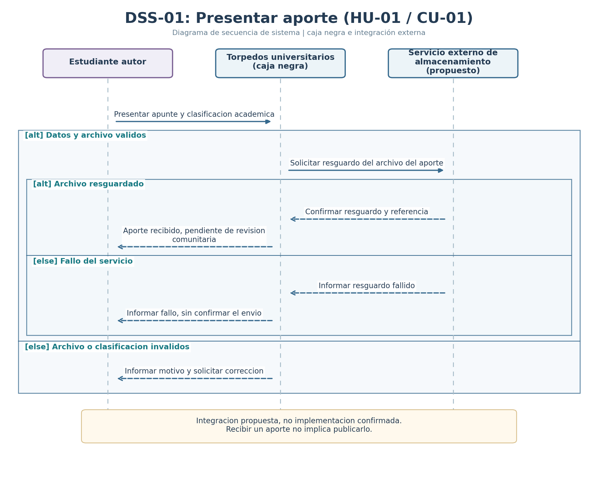
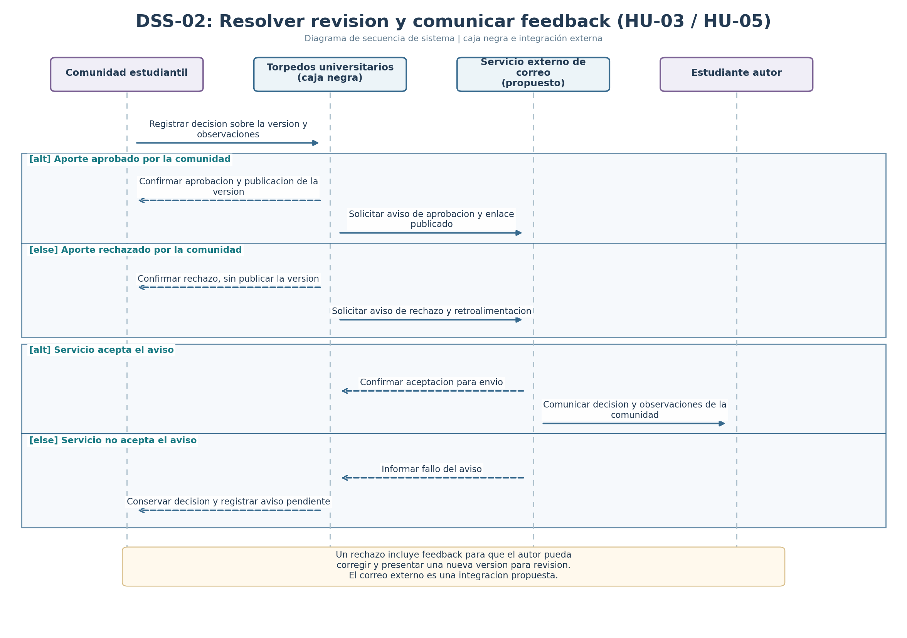

# Diagramas de secuencia de sistema

En ambos diagramas, **Torpedos universitarios** aparece como una única caja negra. Las actividades internas de frontend, backend y base de datos no forman parte de estos diagramas. Los servicios de archivos y correo son integraciones propuestas para la especificación.

## DSS-01: Presentar un aporte para revisión

- Caso de uso: [CU-01](./09-casos-de-uso.md)
- Historia: [HU-01](./04-historias-usuario.md#hu-01)
- Requisitos: [RP-01, RP-02](./03-requisitos.md)
- Integración: servicio externo de almacenamiento de archivos (propuesto).

Fuente editable: [`dss-01.puml`](./diagramas/dss-01.puml)

**Escenario principal:** el estudiante presenta un apunte válido, el servicio externo confirma el resguardo y el sistema deja el aporte pendiente de revisión comunitaria, no publicado.

**Variantes `alt`:** datos de aporte inválidos o imposibilidad de resguardar el archivo. En ambos casos se informa el motivo al autor.

## DSS-02: Registrar la decisión y comunicar el feedback

- Caso de uso principal: [CU-05](./09-casos-de-uso.md)
- Caso relacionado: [CU-03](./09-casos-de-uso.md)
- Historia principal: [HU-05](./04-historias-usuario.md#hu-05)
- Historia relacionada: [HU-03](./04-historias-usuario.md#hu-03)
- Requisitos: [RP-04, RP-06, RP-07](./03-requisitos.md)
- Integración: servicio externo de correo (propuesto).

Fuente editable: [`dss-02.puml`](./diagramas/dss-02.puml)

**Escenario principal:** la comunidad estudiantil registra su decisión. Una aprobación habilita la publicación de esa versión; un rechazo impide la publicación y debe ir acompañado de retroalimentación que el autor pueda consultar.

**Variantes `alt`:** aprobación o rechazo fundamentado; servicio de correo acepta el aviso o registra un fallo. La falla del correo no modifica la decisión guardada.

## Consistencia del proceso

`Estudiante autor presenta apunte` -> `Pendiente de revisión` -> `Comunidad estudiantil revisa` -> `Aprobación y publicación` **o** `Rechazo con feedback` -> `Nueva versión corregida y nueva revisión, si el autor decide reenviar`.
