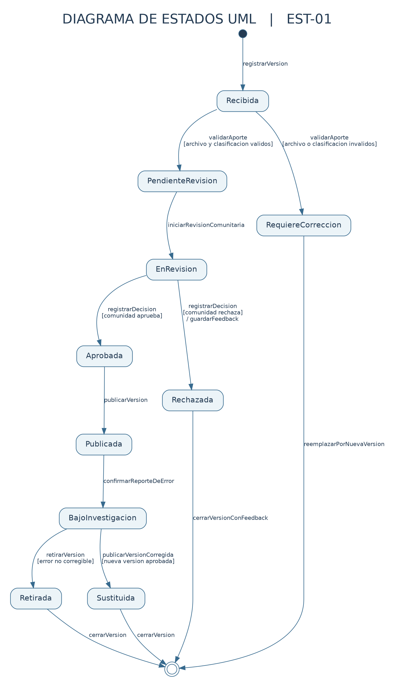
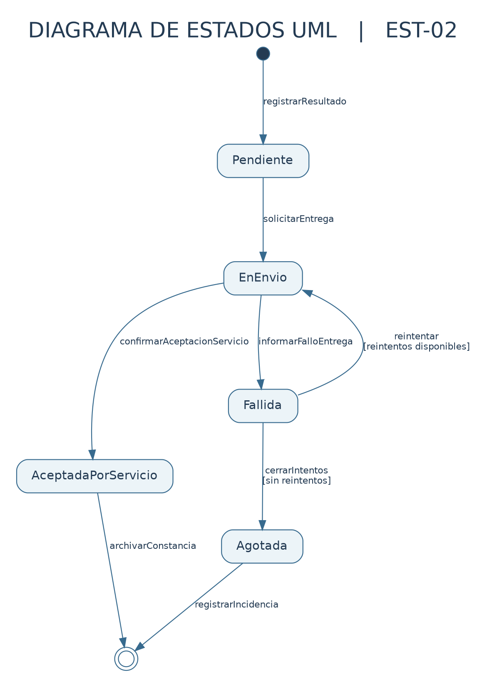

# Diagramas de estado

Los estados representan condiciones de las entidades del dominio. Los eventos indican cuándo una versión o notificación cambia de estado.

## EST-01: Ciclo de vida de VersionApunte

- Clase: [`VersionApunte`](./08-modelo-dominio.md)
- Secuencias relacionadas: [`DSS-01`, `DSS-02`](./10-diagramas-secuencia.md)

Fuente editable: [`est-01.puml`](./diagramas/est-01.puml)

### Tabla de transiciones

| Estado origen | Evento | Guarda | Acción | Estado destino |
|---|---|---|---|---|
| Inicio | registrarVersion | No aplica | Registrar versión | Recibida |
| Recibida | validarAporte | Archivo y clasificación válidos | Dejar pendiente | PendienteRevision |
| Recibida | validarAporte | Archivo o clasificación inválidos | Informar observaciones | RequiereCorreccion |
| PendienteRevision | iniciarRevisionComunitaria | No aplica | Iniciar revisión por estudiantes de la comunidad | EnRevision |
| EnRevision | registrarDecision | Comunidad aprueba | Registrar evaluación | Aprobada |
| EnRevision | registrarDecision | Comunidad rechaza | Guardar feedback obligatorio | Rechazada |
| Aprobada | publicarVersion | No aplica | Publicar la versión aprobada | Publicada |
| Publicada | confirmarReporteDeError | Reporte confirmado | Conservar antecedente | BajoInvestigacion |
| BajoInvestigacion | retirarVersion | Error no corregible | Dejar de publicar | Retirada |
| BajoInvestigacion | publicarVersionCorregida | Nueva versión aprobada | Reemplazar versión pública | Sustituida |
| RequiereCorreccion | reemplazarPorNuevaVersion | No aplica | Mantener trazabilidad | Final |
| Rechazada | cerrarVersionConFeedback | No aplica | Conservar rechazo y feedback | Final |
| Retirada | cerrarVersion | No aplica | Conservar historial | Final |
| Sustituida | cerrarVersion | No aplica | Conservar historial | Final |

Una versión rechazada no cambia a publicada. El estudiante puede crear otra versión corregida del mismo aporte, que vuelve a quedar pendiente de revisión.

## EST-02: Ciclo de vida de Notificacion

- Clase: [`Notificacion`](./08-modelo-dominio.md)
- Secuencia relacionada: [`DSS-02`](./10-diagramas-secuencia.md)

Fuente editable: [`est-02.puml`](./diagramas/est-02.puml)

### Tabla de transiciones

| Estado origen | Evento | Guarda | Acción | Estado destino |
|---|---|---|---|---|
| Inicio | registrarResultado | No aplica | Guardar aviso | Pendiente |
| Pendiente | solicitarEntrega | No aplica | Pedir entrega al correo externo | EnEnvio |
| EnEnvio | confirmarAceptacionServicio | El correo acepta el aviso | Guardar respuesta del servicio | AceptadaPorServicio |
| EnEnvio | informarFalloEntrega | El correo no acepta el aviso | Registrar el fallo | Fallida |
| Fallida | reintentar | Hay reintentos disponibles | Solicitar otro intento | EnEnvio |
| Fallida | cerrarIntentos | No hay reintentos disponibles | Registrar problema | Agotada |
| AceptadaPorServicio | archivarConstancia | No aplica | Guardar constancia | Final |
| Agotada | registrarIncidencia | No aplica | Conservar incidencia | Final |

La aceptación por el servicio externo no demuestra que el autor haya leído el mensaje. La decisión de la comunidad permanece guardada aunque falle el correo.
